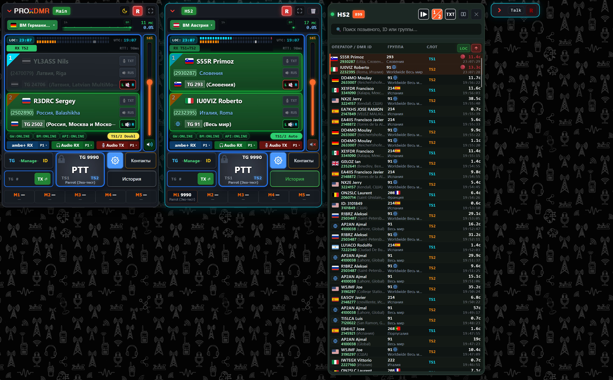
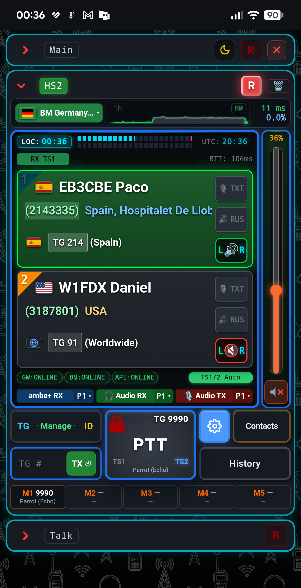
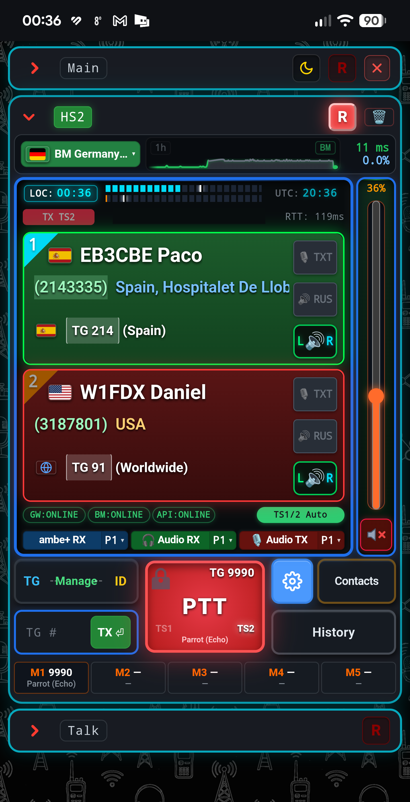

# ProxDMR

**ProxDMR** is a client-server DMR transceiver that connects your web browser or Android smartphone directly to amateur radio networks — **BrandMeister, TGIF, FreeDMR, DMR+ / IPSC2, and XLX Reflectors (D-Star / DMR)** — via the HomeBrew/MMDVM protocol without requiring a physical digital radio, MMDVM modem, or hardware USB vocoder.

**Live Demo:** [https://proxdmr.duckdns.org](https://proxdmr.duckdns.org)

[Features](#key-features) • [Prerequisites](#prerequisites) • [Installation](#installation) • [Configuration](#first-launch--network-configuration) • [Android App](#android-application) • [Operations & Backup](#operations-updates--backup)

<p align="center">
  <a href="docs/images/01.jpg" target="_blank">
    
  </a>
</p>

<p align="center">
  <a href="docs/images/02.png" target="_blank">
    
  </a>
  <a href="docs/images/03.png" target="_blank">
    
  </a>
</p>

## Key Features

* **100% Software Vocoder** — Server-side software AMBE+2 encoding and decoding; no physical transceiver, MMDVM hotspot, or DVStick hardware required.
* **Multi-Hotspot & Multi-Network** — Run multiple independent virtual hotspots simultaneously on one screen across BrandMeister, TGIF, FreeDMR, DMR+ / IPSC2, and XLX Reflectors with full TS1/TS2 and static/dynamic talkgroup support.
* **Ultra-Low Latency Web & Android Clients** — Stream compressed voice (Opus / WebRTC / WebSocket) with tens-of-milliseconds latency in any modern browser or via the dedicated Android app (featuring background audio and screen/hardware PTT).
* **Live Speech-to-Text, Translation & TTS** — Real-time QSO transcription with multi-language translation and on-demand neural TTS voice readout (Silero / Piper).
* **Direct BrandMeister & TGIF API Control** — Subscribe, unlink, and drop active or hung talkgroups directly from the UI.
* **Server Probe & Live Diagnostics** — Benchmark master servers for ping/jitter to auto-select the fastest node, with real-time latency charts.
* **QSO Audio Archive & RadioID Sync** — Automatic synchronization with the RadioID database (312,000+ callsigns) and built-in `.wav` call recorder with instant search by callsign, date, or talkgroup.
* **Multi-User & Guest Demo Mode** — Centralized SQLite database for user accounts, permissions, per-network address books, and read-only guest demo access (`DEMO_MODE=true`).
* **Watchdog, Telegram Alerts & 1-Click Updates** — Independent `watchdog` service monitoring container health, memory usage, and host resources with instant Telegram notifications, plus built-in 1-click system updates from the web UI.
* **Audio Processing & Safety** — Built-in microphone Automatic Gain Control (AGC) and configurable transmission Time-Out Timer (TOT).

## Prerequisites

* **Docker 20.10+** and **Docker Compose v2** on **x86_64** or **ARM64** (Linux, Windows Docker Desktop, Raspberry Pi 4/5, Synology NAS).
* **Amateur Radio Credentials:** Licensed Callsign, DMR ID (registered at [radioid.net](https://www.radioid.net)), and Hotspot Security Passwords for your networks.
* **Open Host Ports:**

| Port | Protocol | Purpose |
| :--- | :--- | :--- |
| `8266` | TCP | Web UI and Android client (HTTPS / WSS) |
| `62031` | UDP | HomeBrew protocol communication with DMR master servers |

## Installation

Choose **Option A** (interactive setup script), **Option B** (pre-built Docker image / Synology GUI), or **Option C** (manual Docker Compose build).

### Option A: Interactive Setup Script (Linux, Raspberry Pi, Windows, NAS SSH)

Download the latest release archive (`ProxDMR-Release.tar.gz` or `ProxDMR-Release.zip`) from [GitHub Releases](https://github.com/owlze/proxdmr/releases) or clone the repository directly. The setup script verifies Docker, prompts for your IP/port, initial admin credentials, and registration policy, generates `.env`, and launches the containers.

**Linux / Raspberry Pi / Synology SSH:**
```bash
git clone https://github.com/owlze/proxdmr.git
cd proxdmr
chmod +x setup.sh && ./setup.sh
```
*(Need Docker on Debian/Ubuntu/Raspberry Pi OS? Run `curl -fsSL https://get.docker.com | sh && sudo usermod -aG docker $USER`, then re-login).*

**Windows (Docker Desktop):**
1. Ensure [Docker Desktop](https://www.docker.com/products/docker-desktop/) is running.
2. Extract `ProxDMR-Release.zip` to `C:\ProxDMR` and double-click **`setup.bat`** (or in PowerShell: `cd C:\ProxDMR` followed by `powershell -ExecutionPolicy Bypass -File .\setup.ps1`).
3. If Windows Defender Firewall prompts for `com.docker.backend`, allow access on **Private networks**.

> **Note on Admin Password:** `ADMIN_PASSWORD` is applied only during initial database creation. Afterward, change passwords in the web UI under **Settings → My Account → Security & Password**.

### Option B: Pre-Built Image & Synology Container Manager (No Build Required)

Use the official multi-arch image (`ghcr.io/owlze/proxdmr:latest`) via `docker-compose.yml` or Synology GUI (**Container Manager → Project → Create → Create docker-compose.yml**):

```yaml
services:
  proxdmr:
    image: ghcr.io/owlze/proxdmr:latest
    container_name: proxdmr
    restart: unless-stopped
    ports:
      - "8266:8266"
      - "62031:62031/udp"
    volumes:
      - ./config:/app/config
      - ./data:/app/data
    environment:
      - HOST_IP=192.168.1.50          # Replace with your server's LAN IP or domain
      - ADMIN_USER=admin
      - ADMIN_PASSWORD=YourSecurePassword
```

Or launch directly with `docker run`:
```bash
docker run -d \
  --name proxdmr \
  --restart unless-stopped \
  -p 8266:8266 \
  -p 62031:62031/udp \
  -v ./config:/app/config \
  -v ./data:/app/data \
  -e HOST_IP=192.168.1.50 \
  -e ADMIN_USER=admin \
  -e ADMIN_PASSWORD=YourSecurePassword \
  ghcr.io/owlze/proxdmr:latest
```

### Option C: Manual Build via Docker Compose

```bash
cp .env.example .env   # Edit .env to configure HOST_IP, ADMIN_USER, ADMIN_PASSWORD, DEMO_MODE, etc.
docker compose up -d --build
```

## First Launch & Network Configuration

1. **Wait 1–2 minutes** on first start while the container generates TLS certificates, initializes the database, and downloads the RadioID directory (check progress with `docker compose logs -f`).
2. Open **`https://<SERVER_IP>:8266`** in your browser.
3. Accept the self-signed TLS certificate warning (*Advanced → Proceed*) — HTTPS is required by browsers for Web Audio and microphone access.
4. Sign in and open **Hotspot Settings** to add one or more virtual hotspots:

| Network | Supported Features & Protocol Options |
| :--- | :--- |
| **BrandMeister** | HomeBrew protocol + API v2 integration, static/dynamic TG management, server latency probe |
| **TGIF Network** | HomeBrew protocol + TGIF API integration, dynamic PTT TG routing (`4000` disconnect), server probe |
| **FreeDMR** | HomeBrew protocol with RPTO options (`TS1=...;TS2=...;DIAL=...`), server probe |
| **DMR+ / IPSC2** | HomeBrew protocol with reflector linking (`StartRef=...`), server probe |
| **XLX Reflectors** | Multiprotocol reflector gateway (D-Star / DMR), module selection (`A–Z`) on TS2 |

## Android Application

1. Download the native APK directly from your running server at **`https://<SERVER_IP>:8266/download/apk`** (or from `src/static/ProxDMR.apk`).
2. Install the APK (allow installation from unknown sources if prompted).
3. Enter your **Server IP/domain**, **Port** (`8266`), optional **Tailscale VPN** auto-connect preference, and login credentials.

## Operations, Updates & Backup

### Persistent Data Layout
All user state is stored on the host outside the container and survives upgrades:

| Host Path | Contents |
| :--- | :--- |
| `.env` | Environment variables (host IP, ports, initial admin credentials, demo mode settings) |
| `config/proxdmr.db` | SQLite database (users, hotspot configs, contacts, call logs) |
| `config/cert.pem`, `config/key.pem`, `config/jwt_secret.key` | TLS certificates and JWT session signing key |
| `config/recordings/` | Recorded QSO audio files (`.wav`) |
| `config/piper_voices/` | On-demand cached Piper TTS voice models |
| `config/backups/` | Automatic source code backups created before in-app updates |
| `data/` | Synchronized RadioID database, TalkGroup cache, and watchdog/alert settings |

### Upgrading
* **1-Click Web UI Update:** Open **Settings → System Update** in the web interface to check for new GitHub releases, automatically back up current code to `config/backups/`, apply the update, and restart the container.
* **Via Pre-Built Image:** Run `docker compose pull && docker compose up -d`.
* **Via Local Build / Git:** Pull or extract the new files over your project directory (`config/`, `data/`, and `.env` remain untouched) and run `docker compose up -d --build`. Database migrations apply automatically on startup.
* **Android App:** Download the updated APK from `https://<SERVER_IP>:8266/download/apk` after upgrading the server.

### Backup, Restore & Useful Commands
* **Backup:** Stop the service (`docker compose down`) and copy `config/`, `data/`, and `.env`.
* **Restore:** Copy `config/`, `data/`, and `.env` into the project root and run `docker compose up -d`.
* **Security Best Practices:** Use strong admin passwords, never share `.env` or `config/`, and prefer VPN access (Tailscale / WireGuard) over exposing ports to the public internet.

```bash
docker compose logs -f          # Follow live container logs
docker compose ps               # Check container status (proxdmr & proxdmr-watchdog)
docker compose restart          # Restart services
docker compose down             # Stop services
docker compose up -d --build    # Rebuild and start in background
```
